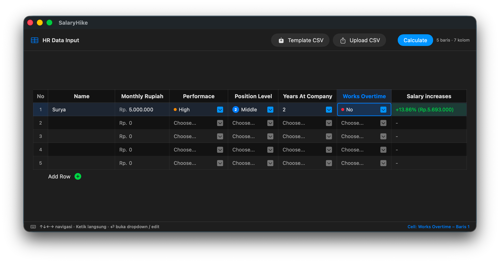

# Salary Increases Recommendation

A macOS desktop application built with SwiftUI to predict employee salary increase recommendations offline using an on-device Machine Learning model (Core ML).



## Features

- **Keyboard-Navigable Table**: Interactive spreadsheet-style table supporting arrow-key navigation, dropdown popups, and inline editing.
- **Bulk CSV Import & Template**: Built-in CSV template download and batch data import with automatic validation and normalization.
- **On-Device Core ML Inference**: Local salary increase predictions calculated with low latency and without network dependencies.
- **End-to-End ML Pipeline**: Complete model training workflow in Python (XGBoost, Optuna hyperparameter tuning, and export to Core ML).

## Tech Stack

| Component | Technology |
| :--- | :--- |
| **Desktop Application** | macOS, SwiftUI, Combine, AppKit |
| **On-Device Model** | Apple Core ML (`salary_hike_v2.mlmodel`) |
| **ML Training Pipeline** | Python 3, XGBoost, Optuna, Scikit-Learn, Coremltools |

## Model Features & Target

| Feature | Data Type | Description / Values |
| :--- | :--- | :--- |
| `Monthly Rupiah` | Numeric | Monthly base salary (IDR) |
| `Performance` | Categorical | `Low` (1), `Medium` (2), `High` (3), `VeryHigh` (4) |
| `Position Level` | Categorical | `Junior` (1), `Middle` (2), `Senior` (3), `Manager` (4), `Executive` (5) |
| `Years At Company` | Numeric | Company tenure in years (0 - 40) |
| `Works Overtime` | Binary | `Yes` (1), `No` (0) |
| **Target Output** | Numeric | Recommended salary increase percentage (%) |

## Getting Started

### Running the macOS App
1. Open the project in Xcode:
   ```bash
   open SalaryIncreasesRecommendation.xcodeproj
   ```
2. Select the `SalaryIncreasesRecommendation` target scheme with **My Mac** as the destination.
3. Press `Cmd + R` to build and run.

### Retraining the ML Model (Optional)
1. Install Python dependencies:
   ```bash
   pip install -r requirements.txt
   ```
2. Launch the Jupyter Notebook pipeline:
   ```bash
   jupyter notebook machine-learning-pipeline/employee-compensation-optimation.ipynb
   ```

## Directory Structure

```text
.
├── SalaryIncreasesRecommendation.xcodeproj
├── requirements.txt
├── machine-learning-pipeline/
│   ├── employee-compensation-optimation.ipynb
│   ├── dataset/
│   └── *.json
└── SalaryIncreasesRecommendation/
    ├── Model/
    ├── View/
    ├── ViewModel/
    └── salary_hike_v2.mlmodel
```
